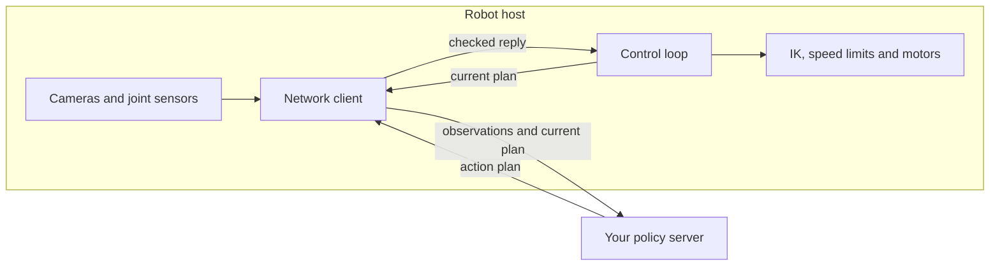

Run Policy and DAgger collection can drive the arms with **your own model**, in any framework. It can be a JAX model, a different PyTorch version, a VLA served elsewhere or a hand-written controller.

1. Wrap the model in a small server with the [`almond_axol.policy`](/api/policy) SDK.
2. Start Run Policy or DAgger collection with `--policy_type custom`.

The robot sends your server the arm state and camera frames, and runs the action chunks it returns. The robot never loads the model.



Your server handles preprocessing, inference, instructions, postprocessing and any blending between chunks. While the server works on a new plan, the robot keeps running the current one. When the new plan arrives, the robot switches to it at the row that is due, so a slow network doesn't stall the arms. See [Timing and continuity](/api/policy-plan#robot-control-loop) for details.

## Write the policy

Install `almond-axol` wherever the model runs. The base install is enough. LeRobot and PyTorch aren't needed. Subclass [`Policy`](/api/policy) and start it with `serve()`:

```python
# my_policy.py
import numpy as np

from almond_axol.policy import Observation, Policy, PolicySpec, serve


class MyPolicy(Policy):
    fps = 30  # optional: refuse a robot running at another rate

    def __init__(self, checkpoint: str, task: str) -> None:
        self.checkpoint, self.task = checkpoint, task

    def setup(self, spec: PolicySpec) -> None:
        # spec.state_names / spec.action_names / spec.cameras say exactly
        # what the robot will send and expect.
        self.model = load_my_model(self.checkpoint)

    def reset(self) -> None:
        self.model.reset()  # episode start, or the robot discarded its plan

    def infer(self, obs: Observation) -> np.ndarray:
        # obs.state   float32, spec.state_names order (radians; gripper 0-1)
        # obs.images  {"overhead": (H, W, 3) uint8 RGB, ...}
        # obs.plan    rows of the current plan still to run, or None
        return self.model.predict(obs.state, obs.images, self.task)  # (T, D)


serve(MyPolicy("myorg/my-model", "pick the red cube"), host="127.0.0.1", port=8765)
```

`infer` returns `T` future targets, one row per control tick, in `spec.action_names` order. See [Action chunks](/api/policy#action-chunks) for the accepted shapes and [State and action names](/api/policy#state-and-action-names) for the layout. If you trained on a dataset from [Data Collection](/operations/data-collection), the names match its `observation.state` and `action` features.

The robot runs each chunk as sent and switches to a new one at the row that is due when it arrives. To keep that switch smooth, do one of these:

- **Continue the motion in progress.** Condition on `obs.plan`, or at least start near `obs.plan[0]`.
- **Ensemble on the server.** Use `serve(..., ensemble=0.01)` for an ACT-style chunked policy trained with temporal ensembling.

`serve()` handles the rest of the [interface](/api/policy-plan). It confirms the session settings, keeps the plans it sent so `obs.plan` works, clears them on reset, and shows your exceptions to the operator. To write the server in another language, follow the [interface reference](/api/policy-plan).

Your policy chooses the model, checkpoint and instruction. On the robot, `--task` only labels recorded episodes, and `--policy_path` is not used.

## Check it without the robot

With the server running, play the robot's side of a session against it:

```bash
axol policy.check --delay_steps 3
```

[`policy.check`](/cli/policy-check) runs the robot's scheduler on a simulated clock, here with 3 ticks of reply delay. It reports:

- replies that arrive too late,
- the server's round-trip time, and
- the largest jumps where one plan hands over to the next.

Match `--cameras`, `--cartesian` and the chunk settings to your robot. `check_policy()` does the same from Python, for unit tests.

## Run on the robot host

Replace the endpoint address and camera serial with your configuration:

```bash
axol run-policy --policy_type custom \
    --server_host 192.0.2.10 --server_port 8765 \
    --task "Pick the red cube" \
    --fps 30 --actions_per_chunk 30 \
    --robot_config.cameras "{overhead: {serial: 41234567}}"
```

The command connects to your server. It doesn't start one. Without `--server_host`, it connects to `127.0.0.1`. An episode can start only when the robot and the server agree on the cameras, state and actions.

To run it from the control panel:

1. Start your `serve()` process. The panel doesn't start it.
2. Assign the cameras.
3. Select **Run policy** and choose policy type **custom**.
4. Enter the task label and leave the policy path blank.
5. Set the server's host and port under **Settings → Inference**. A blank host means this computer, on port 8765 by default.
6. Press **Start**.

The usual episode controls and recording options work. See [`run-policy`](/cli/run-policy) for the controls and settings.

Two settings control timing for custom policies:

- `plan_config.request_interval` (default 5) sets how many actions run between requests.
- `plan_config.max_adoption_offset_steps` (default 6) sets how late a reply may arrive.

The LeRobot chunk settings (`aggregate_fn`, `chunk_size_threshold`, temporal ensembling and chunk alignment) don't change a custom policy's plans. Do any blending on your server. The robot still limits joint speed and acceleration.

## Collect corrections with DAgger

```bash
axol collect-dagger --policy_type custom \
    --server_host 192.0.2.10 --server_port 8765 \
    --task "Pick the red cube" --repo_id myorg/policy-corrections \
    --hold_to_intervene true --record_joint_actions true \
    --home_on_start true --start_from_current_pose true \
    --robot_config.cameras "{overhead: {serial: 41234567}}"
```

- Hold either grip to drive that arm.
- Release both grips to hand back. The robot holds your last command until the policy's new plan arrives, then blends into it.
- The policy can keep predicting while you drive, but its predictions never move the arms.
- Taking over and handing back stay within the same episode, and your frames are labeled as interventions.

DAgger has separate server settings. It reads its shared settings from data collection, not from the **Inference** settings that Run Policy uses. See [`collect-dagger`](/cli/collect-dagger#remote-policies-through-the-custom-policy-interface) for settings, recording, startup homing and shutdown.

## Failure behavior

- A malformed reply, a mismatch in cameras, state or actions, or a lost connection stops the policy.
- When the plan runs out, `plan_config.late_policy` decides what happens. The default holds the arms and requests a new plan. `abort` ends the session.
- The robot never stretches an old plan to fill a gap.
- The robot doesn't reconnect automatically to resume motion.

See [Lifecycle and failure](/api/policy-plan#lifecycle-and-failure) for details.
