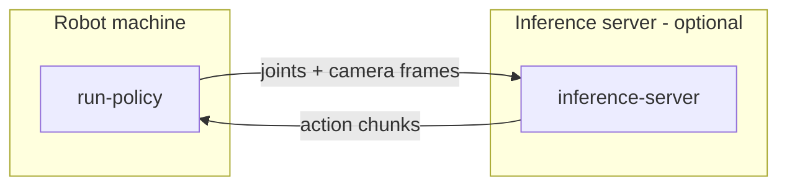

Run Policy lets a trained policy drive Axol's arms. Axol sends the arm positions and camera frames to the policy, and the policy sends back chunks of actions. Run it on the same computer as [data collection](/operations/data-collection): the one wired to the robot with the ZED cameras attached. Start it from the web control panel or with `axol run-policy`.

For LeRobot policies, inference runs on the robot's computer by default. You can move it to a more powerful computer on the network instead. Custom policies connect to an endpoint you run, through the [custom policy interface](/api/policy-plan).



<Tip>
  To run a model that isn't a LeRobot checkpoint, choose policy type **`custom`**. You choose the model and instructions on your endpoint, so the robot needs no checkpoint path. See [Run Your Own Policy](/operations/custom-policy).
</Tip>

## Before you start

- Install Axol with the [one-command install](/installation). Bring up CAN and check the motors.
- Connect at least one of the ZED cameras the policy was trained on, and have their serial numbers ready. See the [Data Collection](/operations/data-collection#before-you-start) tip for how to list them.
- Have a trained checkpoint and its policy type (`act`, `smolvla`, `pi0` and so on). The checkpoint can be a local path or a HuggingFace repo.
- Use the **same** cameras, camera resolution, stereo setting and recording rate the policy was trained on.
- For GPU inference on the robot's computer, you need a PyTorch build with CUDA. Otherwise, use a remote server (below) or pass `--device cpu`.

<Warning>
  Load only checkpoints and datasets that you made or got from a source you trust. Model and dataset loading is not sandboxed.
</Warning>

<Note>
  On a Jetson, the hosted install comes with the CPU-only PyTorch build. For GPU inference, install a JetPack-compatible Torch and Torchvision yourself. Axol's updater doesn't replace a build you installed.
</Note>

## Run it

<Tabs>
  <Tab title="Control Panel">
    <Steps>
      <Step title="Connect the robot and assign cameras">
        Connect the **Axol Host** and **Axol**. Under **Axol settings → Cameras**, assign at least one of the cameras the policy was trained on. See [Cameras](/guides/control-panel#cameras).
      </Step>

      <Step title="Select Run policy and fill in the fields">
        Pick **Run policy** and fill in **Policy path**, **Policy type** and **Task**. The remote server's host and port, and the chunk settings, are in the **Inference** tab of [Settings](/guides/control-panel#settings).
      </Step>

      <Step title="Start and run episodes">
        Press **Start**, then use the **Episode control** box:

        | Button | What it does |
        |---|---|
        | **Start episode** | Start the next episode. |
        | **Save** | Save the episode and wait for the next one. |
        | **Discard** | Drop the episode. The arms go **limp** so you can move them clear by hand. Then press **Return to rest**. |
        | **Return to rest** | Plan a return to rest from where the arms are. Appears after **Discard** or a contact stop. |

        To end the run, press **Stop** at the top of the card.
      </Step>
    </Steps>
  </Tab>

  <Tab title="CLI">
    On the robot's computer:

    ```bash
    axol run-policy \
        --policy_path myorg/pick-place-policy \
        --policy_type act \
        --task "Pick the red cube" \
        --robot_config.cameras "{overhead: {serial: 41234567}, left_arm: {serial: 41234568}, right_arm: {serial: 41234569}}"
    ```

    This starts a policy server on the same computer. For CPU inference, add `--device cpu`.

    Replace the serial numbers with your cameras' and assign the cameras the policy was trained on. Slots you leave out aren't used. The `cameras` value is one inline YAML dictionary. See [Command configuration](/cli/configuration#field-name-conventions).

    Control each episode from the `run-policy` terminal:

    | Key | Action |
    |---|---|
    | `s` | Save the episode. |
    | `r` | Discard the episode. The arms go **limp**. Move them clear, then press **Enter** to return to rest. |
    | `q` | Discard the episode and quit. |

    See [`run-policy`](/cli/run-policy) for the chunk and dataset fields.
  </Tab>
</Tabs>

### Episodes

- `--episode_time_s` limits each episode, 120 s by default. When it runs out, you get the same save, discard or quit choice.
- If you set a dataset repo ID, each saved episode is added to a LeRobot dataset.
- **Discard** makes the arms go limp first, because a failed episode often leaves them in a bad spot. Move them clear by hand, then return to rest.

### Contact stops

Between episodes, the arms return to the rest pose along a path that avoids collisions. The return is guarded. If an arm meets resistance, such as a held object or a person, the move stops and the arms go limp.

1. Move the arms clear by hand.
2. Press **Enter** in the terminal or **Return to rest** in the panel. Axol plans a new return from where the arms are.

Set the sensitivity with **Reset contact threshold** in the panel, or `--reset_torque_threshold` (default `6.0` Nm, `0` turns it off).

You can also stop an episode when the arms push hard while the policy drives them. This check is off by default, because a policy often pushes on the scene on purpose. Set **Policy contact stop** in the panel, or `--policy_torque_threshold`. The panel suggests `16` Nm.

When it trips, the episode is dropped without saving and the arms go limp. Move them clear, then return to rest and start the next episode.

### Smooth motion

Axol limits joint speed and acceleration on every command the policy sends. For LeRobot policies, Axol also blends overlapping chunks (`--ensemble_blend_s`, `--align_fade_s`). A custom policy's server does any blending itself, and Axol runs its plan as sent.

Smooth motion still needs consistent targets and fast enough inference. See [`run-policy`](/cli/run-policy) and [custom policy timing](/api/policy-plan#robot-control-loop).

## Offload LeRobot inference to a remote server (optional)

<Warning>
  Use remote inference only on an isolated, trusted network or a VPN. Set the server's firewall to accept only the robot's IP address. The link is not encrypted or authenticated. Anyone on the network could load checkpoints on the server, or pose as the server and send actions to the robot.
</Warning>

<Steps>
  <Step title="Start the inference server on the GPU computer">
    Start the server from the CLI. The control panel doesn't run it. Install the `lerobot` extra on the GPU computer, then run:

    ```bash
    axol inference-server --host 192.168.1.99
    ```

    Replace the address with the GPU computer's LAN IP. Leave out `--host` to listen on all interfaces (`0.0.0.0`). The server listens on port `8765` until you press `Ctrl+C`. See [`inference-server`](/cli/inference-server).
  </Step>

  <Step title="Point Run Policy at it">
    On the robot's computer, run Run Policy as above with the server's address:

    <Tabs>
      <Tab title="Control Panel">
        In the **Inference** tab of [Settings](/guides/control-panel#settings), set the server host to the GPU computer's address, such as `192.168.1.99`, and press **Save**. Then press **Start** in the **Run policy** panel.
      </Tab>

      <Tab title="CLI">
        Add `--server_host`:

        ```bash
        axol run-policy \
            --policy_path myorg/pick-place-policy \
            --policy_type act \
            --task "Pick the red cube" \
            --server_host 192.168.1.99 \
            --robot_config.cameras "{overhead: {serial: 41234567}, left_arm: {serial: 41234568}, right_arm: {serial: 41234569}}"
        ```
      </Tab>
    </Tabs>

    The server downloads the policy, so it must be able to reach `--policy_path`. A HuggingFace Hub repo ID works.
  </Step>
</Steps>

## Next steps

<CardGroup cols={2}>
  <Card title="Config Parameters" icon="sliders" href="/operations/run-policy-config">
    Every setting for run policy, with its default.
  </Card>
  <Card title="Data Collection" icon="record-vinyl" href="/operations/data-collection">
    Record more episodes to improve the policy.
  </Card>
  <Card title="run-policy reference" icon="terminal" href="/cli/run-policy">
    Every flag and aggregation strategy.
  </Card>
  <Card title="Run Your Own Policy" icon="code" href="/operations/custom-policy">
    Drive the arms from a model that isn't a LeRobot checkpoint.
  </Card>
</CardGroup>
